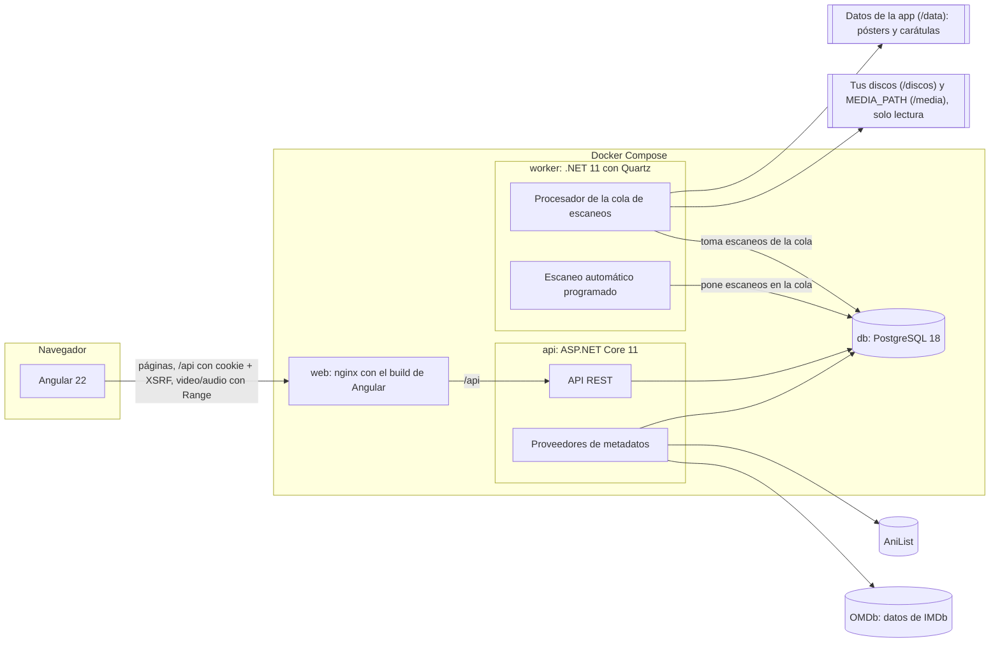
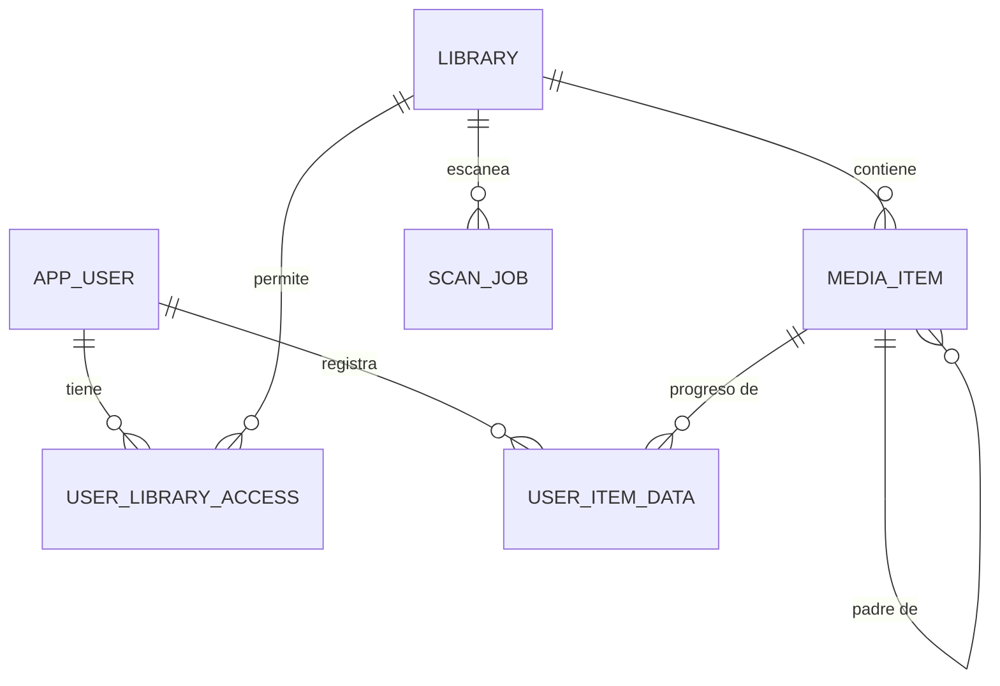

# Plan: gestor de contenido multimedia (JellyfinClon)

Aplicación web para organizar y reproducir tu propia colección de música, películas, series y anime. Toma como referencia la funcionalidad básica de Jellyfin, pero con código, modelo de datos y diseño propios. Es un proyecto de portafolio: pequeño de mantener y pensado para mostrar buenas prácticas con .NET, EF Core Code First, PostgreSQL y Angular.

> **Nombre de trabajo: Mediateca.** Para el repositorio público usa un nombre propio en lugar de "Jellyfin", que es el nombre de otro proyecto. En tu sitio aparecerá como "Gestor de contenido multimedia".

Dónde vive cada cosa:

- **Este plan:** `C:\Users\rafik\Downloads\Claude\ProyectosPortafolio\JellyfinClon\PLAN.md`. En la fase 0 se copia a la raíz del repositorio.
- **Código:** `F:\Respaldo\Respaldo\Cursos\JellifinClon`.
- **Repositorio:** <https://github.com/RafaelLeonTorres/mediateca> (público), creado en la fase 0.

---

## 1. Alcance

### Incluye (MVP)

- **Bibliotecas** de música y de video (películas, series y anime). Cada una apunta a una o varias carpetas del servidor.
- **Escaneo** de esas carpetas: detecta archivos nuevos, modificados y eliminados.
- **Metadatos** de cada película, serie y anime: título, año, clasificación, resumen, géneros, calificación y póster. Las películas y series los toman de IMDb (a través de OMDb) y el anime de AniList, que además trae estudios, etiquetas, fondo y horario de emisión, como en Jellyfin. La música usa las etiquetas de sus archivos.
- **Identificar**: corregir una coincidencia equivocada buscando de nuevo o pegando el ID de IMDb (`tt0118799`) o de AniList (el número de su dirección, `anilist.co/anime/21`).
- **Usuarios y permisos**: el administrador crea usuarios y decide a qué bibliotecas entra cada uno.
- **Reproducción en el navegador**: video con avance y retroceso, música por álbum con una barra de reproducción fija, y "Continuar viendo".
- **Primer arranque**: si la base de datos no existe, la app la crea con sus tablas; si no hay usuarios, pide crear al administrador.

### No incluye (extensiones posibles)

- Transcodificación con FFmpeg: el MVP reproduce solo los formatos que el navegador soporta.
- Subtítulos, TV en vivo, DLNA, apps móviles, plugins y perfiles infantiles.
- Otros proveedores, como TMDb (resúmenes en español), AniDB o MusicBrainz (música). La arquitectura los admite, pero no entran en el MVP.

---

## 2. Tecnologías

| Capa | Tecnología |
|---|---|
| Backend | .NET 11 (C# 15) y ASP.NET Core 11 |
| Datos | EF Core 11, Code First con migraciones |
| Base de datos | PostgreSQL 18; PostgreSQL 19 cuando salga (lanzamiento planeado para el 19 de noviembre de 2026) |
| Proveedor de EF | Npgsql.EntityFrameworkCore.PostgreSQL 11 |
| Autenticación | ASP.NET Core Identity con cookie |
| Frontend | Angular 22 (última 22.x), Angular Material, zoneless y Vitest |
| Música | TagLibSharp para leer etiquetas y carátulas |
| Tareas programadas | Quartz.NET 4.7.3 en el worker (escaneo automático con expresiones cron) |
| Pruebas | xUnit, Moq, Testcontainers (PostgreSQL) y WebApplicationFactory; Vitest en Angular |
| Infraestructura | Docker Compose con cuatro contenedores (nginx con Angular, API, worker y PostgreSQL) y GitHub Actions |

Notas de versiones:

- .NET 11 salió el 10 de noviembre de 2026. Es STS y tiene soporte hasta noviembre de 2028, igual que .NET 10.
- Angular pasó a una versión mayor por año: la 22 (junio de 2026) es la vigente y la 23 está prevista para junio de 2027. Desde la 21, los proyectos nuevos son zoneless y usan Vitest para las pruebas.
- EF Core 11 lanza un error si `MigrateAsync` no encuentra migraciones, así que la primera migración se genera antes de arrancar la API. Las APIs síncronas solo dejaron de funcionar en el proveedor de Cosmos DB; aun así, el proyecto usa siempre las asíncronas (`MigrateAsync`, `SaveChangesAsync`, `ToListAsync`).
- EF Core 11: las colecciones primitivas (`List<string>` como `text[]`) se configuran con `PrimitiveCollection`, ya no con `Property`.
- **Quartz.NET 4.7.3:** solo se instala el paquete `Quartz`. En la serie 4.x, `Quartz.Extensions.Hosting` y `Quartz.Extensions.DependencyInjection` son paquetes vacíos: `AddQuartz` y `AddQuartzHostedService` ya vienen en `Quartz`. En 4.x, `IJob.Execute` devuelve `ValueTask` y recibe un `CancellationToken`.
- **Npgsql EF Core 11:** en la fase 0 confirma en NuGet si ya hay versión estable. Si todavía no, usa la última preliminar 11.0 y actualiza en cuanto salga la estable.

---

## 3. Arquitectura



Decisiones principales:

- **Cuatro contenedores, un solo origen:** `web` (nginx) sirve el build de Angular y manda `/api` al contenedor `api`; `worker` corre los escaneos (sección 7); `db` es PostgreSQL. El navegador solo habla con `web`, así que la app y la API comparten origen. En desarrollo, `ng serve` hace lo mismo con `proxy.conf.json`. nginx pasa `/api` sin búfer para que el streaming con `Range` llegue directo al navegador.
- **Primer arranque con un comando:** `setup.ps1` (o `docker compose up -d --build --wait`) construye las imágenes y levanta todo; Compose espera a que cada contenedor esté sano antes de arrancar el siguiente (`db` → `api` → `web` y `worker`; el worker espera a la API porque es la API quien aplica las migraciones).
- **Cookie en lugar de JWT:** las etiquetas `<video>` y `<audio>` no pueden enviar la cabecera `Authorization`, pero sí envían cookies. Con una cookie del mismo origen el streaming queda autenticado sin poner tokens en las URL.
- **Escaneo en un worker, con la base de datos como cola:** la API solo pone un `ScanJob` en estado `Queued` y responde al instante; el contenedor `worker` los toma y los corre (sección 7). Así un escaneo largo no compite con la API por memoria ni por CPU, y la cola sobrevive a un reinicio de la API.

Estructura de carpetas:

```text
JellifinClon/                          F:\Respaldo\Respaldo\Cursos\JellifinClon (raíz del repositorio)
├── PLAN.md                            copia de este plan
├── README.md                          primer arranque, uso diario, configuración y desarrollo
├── setup.ps1                          primer arranque en Windows: crea .env, monta tus discos y levanta los contenedores
├── bandeja.ps1                        instala el ícono de la bandeja de Windows
├── docker-compose.yml                 web, api, worker y db
├── .env.example                       contraseña, puertos, carpeta de medios, horario de escaneo y zona horaria (se copia a .env)
├── backend/
│   ├── Dockerfile                     imágenes de la API y del worker (SDK para compilar, ASP.NET Core para correr)
│   ├── Mediateca.slnx
│   ├── src/
│   │   ├── Mediateca.Api/             endpoints, autenticación y archivos de Angular
│   │   ├── Mediateca.Core/            entidades, reglas, analizadores de nombres e interfaces
│   │   ├── Mediateca.Infrastructure/  EF Core, migraciones, escáner, cola de escaneos, OMDb, AniList e imágenes
│   │   ├── Mediateca.Worker/          escaneos de la cola, escaneo automático con Quartz y señal de vida
│   │   └── Mediateca.Tray/            ícono de la bandeja de Windows (WinForms): iniciar, detener, abrir y registros
│   └── tests/
│       ├── Mediateca.UnitTests/
│       └── Mediateca.IntegrationTests/  Testcontainers + WebApplicationFactory
└── frontend/                          Angular 22
    ├── Dockerfile                     compila Angular con Node y lo sirve con nginx
    └── nginx.conf                     archivos de Angular, rutas de la SPA y proxy de /api
```

---

## 4. Modelo de datos (EF Core Code First)



| Entidad | Campos principales |
|---|---|
| `Library` | Id, Name, Type (`Movies`, `Series`, `Anime`, `Music`), Paths (`text[]`), CreatedAt, LastScannedAt |
| `MediaItem` (abstracta) | Id, LibraryId, ParentId, Title, SortTitle, Year, Overview, ContentRating, CommunityRating, Genres (`text[]`), ImdbId, AniListId, PosterPath, DateAdded, MetadataStatus (`Pending`, `Matched`, `NotFound`, `Error`) |
| `PlayableItem` (abstracta, hereda de `MediaItem`) | FilePath, FileSize, FileModifiedAt, DurationSeconds |
| `Movie`, `Episode`, `Track` | heredan de `PlayableItem`. Episode: SeasonNumber, EpisodeNumber, AbsoluteNumber. Track: TrackNumber, DiscNumber, Artist |
| `Series`, `Season`, `MusicAlbum` | heredan de `MediaItem`. Season: SeasonNumber. MusicAlbum: AlbumArtist |
| `AppUser` | `IdentityUser<Guid>` + DisplayName, CreatedAt |
| `UserLibraryAccess` | UserId, LibraryId (llave compuesta) |
| `UserItemData` | UserId, ItemId, PositionSeconds, Played, LastPlayedAt (llave compuesta) |
| `MetadataCache` | Provider, ExternalId, Payload (`jsonb`), FetchedAt (llave compuesta Provider + ExternalId) |
| `ScanJob` | Id, LibraryId, Status (`Queued`, `Running`, `Completed`, `Failed`), CreatedAt, StartedAt, FinishedAt, Added, Updated, Removed, Errors, ErrorMessage. Es también la cola de escaneos |
| `ScanSchedule` | Id (siempre 1), Enabled, CronExpression, UpdatedAt: el horario del escaneo automático |

Detalles que vale la pena mostrar en el portafolio:

- **Herencia TPH** (una tabla con discriminador) para todos los tipos de `MediaItem`: así una sola consulta sirve para búsquedas, "Agregado recientemente" y "Continuar viendo".
- **Tipos de PostgreSQL:** `text[]` para las rutas de las bibliotecas y los géneros, y `jsonb` para la caché de metadatos.
- **Búsqueda rápida:** la extensión `pg_trgm` con un índice GIN sobre `Title` acelera los `ILIKE '%texto%'` (`HasPostgresExtension("pg_trgm")` e índice con `gin_trgm_ops`).
- **Índice único** en (LibraryId, FilePath) para que un archivo no se registre dos veces.
- **Índice único parcial** en `ScanJob` (`IX_ScanJobs_LibraryId_Active`): sobre `LibraryId`, solo para los estados `Queued` y `Running`. La base de datos garantiza un escaneo activo por biblioteca, sin candados en la aplicación.

---

## 5. Primer arranque

1. Al iniciar, la API ejecuta `await db.Database.MigrateAsync()`. Si la base no existe, Npgsql la crea y aplica todas las migraciones; si ya existe, solo aplica las pendientes. El usuario de PostgreSQL necesita permiso `CREATEDB`.
2. Los roles `Admin` y `Usuario` se siembran con `UseAsyncSeeding` de EF Core.
3. Se crea la carpeta de datos de la app (`data/`; en Docker, el volumen `appdata` montado en `/data`) para los pósters y los fondos descargados.
4. `GET /api/setup/status` responde `{ "needsSetup": true }` mientras no haya usuarios. Angular manda entonces a `/setup`, donde se crea el administrador con `POST /api/setup`. Ese endpoint solo funciona mientras no exista ningún usuario; después responde 404.

---

## 6. Usuarios y permisos

- Identity con llaves `Guid` y roles `Admin` y `Usuario`. No hay registro público: solo el administrador crea cuentas.
- El administrador puede crear, editar y desactivar usuarios, restablecer contraseñas y marcar a qué bibliotecas entra cada uno.
- **Regla de visibilidad:** un usuario ve una biblioteca solo si existe `UserLibraryAccess(UserId, LibraryId)`; el administrador ve todas.
- La regla vive en un método de extensión (`VisibleTo(userId, isAdmin)`) que usan los listados, la búsqueda y las filas de inicio. Los endpoints de un elemento, sus hijos, su imagen y su stream responden **404** si el usuario no tiene acceso, para no revelar que el elemento existe.
- Las pruebas de integración verifican esta regla con dos usuarios.

---

## 7. Escaneo de bibliotecas

- **Cada biblioteca tiene su tipo (películas, series, anime o música) y sus propias carpetas, y se configura solo desde la app.** No hace falta configurar ninguna ruta antes de arrancar, y la app arranca aunque no haya bibliotecas ni carpetas.
- En Docker, los discos del equipo se montan de solo lectura en `/discos/<letra>` (`/discos/C`, `/discos/F`...) dentro de `api` y `worker`. En Windows los genera `setup.ps1` en un `docker-compose.override.yml` (un montaje de larga sintaxis por disco fijo, con el comentario `# Generado por setup.ps1` en la primera línea; si ya existe un override sin esa marca, el script no lo toca). Al conectar un disco nuevo se vuelve a correr `setup.ps1`. En Linux y macOS el override se escribe a mano (ver README). Los montajes reemplazan a la carpeta única `/media`: `MEDIA_PATH` sigue existiendo, pero es opcional (por ejemplo, para un NAS) y su valor por omisión es `./media`.
- Las carpetas permitidas son `Storage:MediaRoots` (una lista; por omisión `/media`) más `Storage:DrivesPath` (por omisión `/discos`), que se agrega siempre a esa lista. La API rechaza cualquier carpeta de biblioteca fuera de esas raíces, y el selector de carpetas de la administración (`GET /api/admin/folders`) solo navega dentro de ellas: la lista inicial muestra "Disco C:", "Disco F:"... (una entrada por subcarpeta de `/discos`) y "Carpeta de medios" (`/media`), y subir desde un disco regresa a esa lista. Si una de estas carpetas no existe, simplemente no aparece nada. Fuera de Docker (por ejemplo, con `dotnet watch`) se define con user-secrets: `Storage:MediaRoots:0`.
- **Rutas para mostrar:** en la base de datos y en la API las carpetas son rutas del contenedor (`/discos/F/Peliculas`), y el cliente siempre manda esas. Para la pantalla, `MediaPaths.ToDisplayPath` las convierte a `F:\Peliculas` (`/discos/F` es `F:\`; lo que está en `/discos/<nombre que no es una letra>` y cualquier otra ruta se muestra igual). Las entradas del selector traen `displayPath` y las bibliotecas del administrador traen `displayPaths`, en el mismo orden que `paths`.
- **Carpetas que no están:** si una carpeta de la biblioteca no se puede leer (por ejemplo, un disco desconectado), el escaneo termina como completado, no borra nada de lo que había en ella y deja en `ErrorMessage` un aviso en español con las rutas para mostrar; la pantalla de bibliotecas lo muestra. Si el disco desconectado es uno de los montados, Docker no puede iniciar `api` ni `worker` hasta que vuelva o hasta que se corra `setup.ps1` de nuevo (el origen de un montaje tiene que existir).
- Se dispara con un botón en la administración (`POST /api/admin/libraries/{id}/scan`, o `POST /api/admin/libraries/scan-all` para todas) y, de forma automática, con el horario de más abajo. En los dos casos solo se pone un `ScanJob` en la cola; quien escanea es el worker.
- `ScanJob` guarda el avance y Angular lo consulta cada 2 segundos; SignalR queda como extensión. Si un escaneo sigue en cola después de 30 segundos, la pantalla avisa que quizá el worker no está corriendo.
- **Incremental:** compara ruta, tamaño y fecha de modificación con lo guardado. Lo nuevo se crea, lo modificado se actualiza y lo que ya no existe se elimina. Los cambios se guardan en lotes.
**Worker y cola en la base de datos**

- **Solo el worker corre escaneos.** El contenedor `worker` (`Mediateca.Worker`) comparte la imagen base y el código de `Mediateca.Infrastructure` con la API. La API y el escaneo programado únicamente ponen escaneos en la cola.
- **La cola es la tabla `ScanJobs`** (filas en `Queued`). El worker busca cada 3 segundos (`Scanning:QueuePollInterval`) y, mientras haya escaneos, los corre uno tras otro.
- **Reclamo con actualización condicional:** toma el `Queued` más antiguo y lo pasa a `Running` con `UPDATE ... WHERE Id = x AND Status = 'Queued'` (`ExecuteUpdateAsync`). Si la actualización cambia una fila, ese escaneo es suyo; si cambia cero, otro procesador se lo ganó y vuelve a mirar. Es seguro aunque haya varios workers y no usa SQL a mano.
- **Un escaneo activo por biblioteca:** el índice único parcial lo garantiza. Si dos solicitudes simultáneas intentan crear un escaneo de la misma biblioteca, la segunda recibe la violación de índice único y devuelve el escaneo que ya existe: las dos respuestas llevan el mismo id.
- **Reinicios:** al arrancar, el worker marca como `Failed` los escaneos que estaban en `Running` (quedaron huérfanos) y deja intactos los que estaban en `Queued`. Si lo detienen a media corrida, el escaneo en curso queda como `Failed` con un mensaje en español.
- Las migraciones las aplica solo la API. Compose inicia el worker cuando la API ya está sana, y su healthcheck revisa que el archivo `/tmp/mediateca-worker.alive` se haya actualizado en los últimos 2 minutos (el worker lo escribe cada 30 segundos).

**Escaneo automático (Quartz)**

- El horario es una sola fila de `ScanSchedules`. Mientras no exista, se usa `Scanning:DefaultCron` (`SCAN_CRON` en `.env`; por defecto `0 0 3 * * ?`, todos los días a las 3:00) y `Scanning:DefaultEnabled`.
- El administrador lo cambia en **Administrar › Bibliotecas › Escaneo automático** (`GET` y `PUT /api/admin/scan-schedule`): un interruptor y una frecuencia (cada hora, cada 6 o 12 horas, diario, semanal o un cron propio). La pantalla muestra la zona horaria y las próximas 3 ejecuciones.
- El worker revisa el horario cada 30 segundos (`Scanning:ScheduleSyncInterval`) con una tarea de Quartz; si cambió, quita el disparador anterior y programa el nuevo. Un cambio guardado en la administración se aplica en menos de un minuto, sin reiniciar nada.
- En cada disparo, la tarea `ScheduledLibraryScanJob` pide el escaneo de todas las bibliotecas (las que ya tienen uno activo no se duplican).
- **Zona horaria:** los horarios se interpretan en la zona del servidor, que en Docker sale de la variable `TZ` (por defecto `America/Mexico_City`; la imagen incluye `tzdata`).
- **Formato cron de Quartz**, con segundos y seis campos (`segundo minuto hora día-del-mes mes día-de-la-semana`); el día del mes o el de la semana tiene que ser `?`:

  | Cron | Cuándo |
  |---|---|
  | `0 0 * * * ?` | Cada hora |
  | `0 0 */6 * * ?` | Cada 6 horas |
  | `0 0 */12 * * ?` | Cada 12 horas |
  | `0 0 3 * * ?` | Todos los días a las 3:00 |
  | `0 0 3 ? * SUN` | Los domingos a las 3:00 |

- **Intervalo mínimo de 5 minutos** (`Scanning:MinimumInterval`): la API rechaza con un 400 los horarios que disparan más seguido (se revisan las próximas ejecuciones, no solo las dos primeras).

- Extensiones reconocidas: video `.mp4 .m4v .webm .mkv` y audio `.mp3 .m4a .aac .flac .ogg .opus .wav`.

Convenciones de nombres:

| Biblioteca | Estructura esperada | Ejemplo |
|---|---|---|
| Películas | `Nombre (Año)/archivo` o `Nombre (Año).ext` | `Películas/Big Buck Bunny (2008)/Big Buck Bunny (2008).mp4` |
| Series | `Serie (Año)/Temporada NN/… SxxEyy` | `Series/Mi Serie (2019)/Temporada 01/Mi Serie S01E02.mkv` |
| Anime | `Serie/… - NN` o `Serie/NN.ext` (número absoluto), o `SxxEyy`; se ignoran las etiquetas entre corchetes | `Anime/Mi Anime/[Grupo] Mi Anime - 05 [1080p].mkv` o `Anime/Mi Anime/Lat/05.mp4` |
| Música | `Artista/Álbum/NN - Canción`, completado con las etiquetas del archivo | `Música/Artista/Álbum (2020)/01 - Canción.flac` |

- Etiquetas opcionales en el nombre de la carpeta para no depender de la búsqueda: `[imdbid-tt0118799]` y `[anilistid-21]` (en la fase 4 reemplaza a `[anidbid-23]`).
- **Carpetas dentro de una serie:**
  - Una carpeta de temporada (`Temporada 01`, `Season 2`, `Especiales`) es esa temporada.
  - Cualquier otra carpeta dentro de la serie se muestra con su nombre tal cual, como una temporada sin número con sus propios episodios, igual que en Jellyfin. Por ejemplo, `Lat` y `Sub` con los mismos episodios en dos idiomas.
  - Si hay carpetas anidadas, el nombre las une con ` / `.
- **Especiales:** `Especial01`, `Special 2`, `SP03` u `OVA 1` en el nombre del archivo van a la temporada 0 ("Especiales"). Si están dentro de una carpeta, se quedan en ella.
- **Imágenes junto a los medios**, con los nombres con que Jellyfin las guarda junto a los videos:
  - `poster`, `folder` o `cover` (`.jpg`, `.jpeg` o `.png`) es el póster de la serie, la película o el álbum. Cada carpeta de la serie usa el suyo o, si no tiene, el de la serie.
  - `NN-thumb.jpg` (el nombre del video más `-thumb`) es la miniatura del episodio.
- **Volver a escanear** recalcula dónde va cada episodio aunque su archivo no haya cambiado, y lo mueve sin cambiarle el id. Así se acomoda lo que se escaneó con reglas anteriores, sin perder el progreso.
- Los analizadores de nombres son funciones puras en `Core`, cubiertas con muchas pruebas `[Theory]`.

---

## 8. Metadatos

### IMDb a través de OMDb

La API oficial de IMDb solo se ofrece de pago por AWS Data Exchange, y los conjuntos de datos gratuitos para uso no comercial no incluyen resúmenes ni pósters. Por eso se usa **OMDb**, que trabaja con los mismos IDs de IMDb:

- Clave gratuita con un límite de 1,000 solicitudes al día.
- Entrega `Title`, `Year`, `Rated` (clasificación), `Plot` (resumen; `plot=full` para el largo), `Genre`, `imdbRating` y `Poster`, y acepta `type=movie|series|episode`.
- Flujo: buscar por título y año, elegir el ID de IMDb, pedir el detalle (`i=tt…&plot=full`) y, en series, los episodios por temporada (`i=tt…&Season=N`).

### AniList

API GraphQL pública en `https://graphql.anilist.co`: una sola dirección, con solicitudes `POST` en JSON. Es la fuente de los datos que muestra Jellyfin para el anime: resumen, géneros, etiquetas, estudios y emisión.

- **No pide cuenta ni clave** para leer datos públicos. Es gratuita para uso no comercial, y "AniList" no se puede usar como nombre de la app.
- **Límite de solicitudes:** normalmente 90 por minuto, pero hoy está en modo degradado con 30 por minuto, además de un limitador de ráfagas. Quien se pasa queda bloqueado 1 minuto, y las respuestas de ese bloqueo traen `Retry-After` y `X-RateLimit-Reset`. Todas traen `X-RateLimit-Limit` y `X-RateLimit-Remaining`.
- **Búsqueda:** `Page(perPage: 10) { media(search: $titulo, type: ANIME) }` con el nombre de la carpeta, sin el año entre paréntesis ni "Season 2" o "2nd Season". Gana el resultado más parecido al título (romaji, inglés o sinónimos); el año y el formato (`TV`, `MOVIE`, `OVA`, `ONA`, `SPECIAL`) desempatan, y si la carpeta dice "Season 3" se prefiere el resultado de esa temporada.
- **Detalle (`Media(id: …)`):**
  - Títulos: `title` (`romaji`, `english`, `native`).
  - Resumen: `description`. Llega con HTML; se limpia a texto con saltos de línea.
  - Fechas y estado: `startDate`, `endDate`, `status`, `season` y `seasonYear`.
  - Episodios: `episodes` y `duration`.
  - Clasificación: `genres` y `tags` (sin los marcados como spoiler).
  - Producción: `studios` (el de animación primero).
  - Calificación y contenido: `averageScore` (de 0 a 100) e `isAdult`.
  - Imágenes: `coverImage.extraLarge` (póster) y `bannerImage` (fondo).
  - Emisión: `nextAiringEpisode`, para "Se emite los martes a las 23:00".
  - Enlaces: `externalLinks` e `idMal`.
  - `streamingEpisodes`: títulos y miniaturas de episodios, cuando los hay.
- Los errores llegan en un arreglo `errors`; un 404 significa que no existe ese ID.
- Las carpetas Lat y Sub no cambian nada aquí: los datos son de la serie y sus carpetas los comparten.

### Qué se guarda como "clasificación"

- Películas y series: el campo `Rated` de OMDb (`PG-13`, `TV-MA`, etc.).
- Anime: "18+" cuando AniList lo marca como `isAdult`; si no, queda sin clasificación.
- La calificación de la comunidad se guarda aparte, en `CommunityRating`, de 0 a 10: la de IMDb tal cual y la de AniList (`averageScore`) dividida entre 10.

### Implementación

- Interfaz `IMetadataProvider` (`SearchAsync`, `GetDetailsAsync`) con `OmdbProvider` y `AniListProvider`. El proveedor depende del tipo de biblioteca: películas y series usan OMDb, y anime usa AniList, también para las películas de anime que están en esa biblioteca.
- `HttpClient` tipados con tiempos de espera (`Microsoft.Extensions.Http.Resilience`). AniList tiene un limitador compartido de 1 solicitud cada 2 s (`System.Threading.RateLimiting`, 30 por minuto). Ante un 429, la cola espera lo que diga `Retry-After` antes de seguir.
- La cola de metadatos la procesa el worker, igual que los escaneos. La API solo consulta a los proveedores cuando el administrador usa Identificar.
- `MetadataCache` guarda cada respuesta. Si OMDb responde "Daily request limit reached!", la cola de metadatos se pausa hasta el día siguiente.
- Después de cada escaneo, los elementos `Pending` entran en una cola de metadatos. El estado (`Matched`, `NotFound`, `Error`) se ve en la administración.
- **Identificar:** un diálogo muestra los resultados de búsqueda del proveedor y permite pegar un ID directamente. **Actualizar metadatos** vuelve a pedir los datos, respetando la caché.
- **Imágenes:** mandan las que dejó Jellyfin junto a los videos (`folder.jpg`, `backdrop.jpg` y `01-thumb.jpg`). Si no hay, el póster y el fondo del proveedor se descargan una sola vez a `data/images/` y se sirven con cabeceras de caché desde `/api/items/{id}/image`. AniList entrega direcciones completas de sus imágenes.
- Los resúmenes de OMDb y AniList llegan en inglés. Para tenerlos en español haría falta agregar TMDb como tercer proveedor (extensión).

---

## 9. Reproducción

- `GET /api/items/{id}/stream`: valida el acceso y responde con `TypedResults.PhysicalFile(ruta, mime, enableRangeProcessing: true)`. Así acepta `Range` y responde 206, que es lo que permite adelantar y regresar. La ruta siempre sale de la base de datos y se verifica que esté dentro de la carpeta de la biblioteca.
- Formatos del MVP: MP4 (H.264/AAC) y WebM para video; MP3, AAC/M4A, FLAC y Ogg/Opus para audio. Si el navegador no puede reproducir un archivo (por ejemplo, un MKV con códecs incompatibles), la app lo indica y ofrece descargarlo. Reempaquetar con FFmpeg queda como extensión.
- **Progreso:** Angular guarda la posición cada 10 segundos, al pausar, al terminar y al salir (en la salida, con `fetch` y `keepalive`, leyendo el token XSRF de la cookie). El servidor hace el alta o la actualización (`PUT /api/items/{id}/progress`); si la posición pasa del 90 % de la duración, marca el elemento como visto y regresa la posición a 0. Sin duración conocida el servidor nunca lo marca como visto: el cliente avisa con `POST /api/items/{id}/played` cuando el video termina. Una posición menor al 90 % no quita la marca de visto. Valores negativos o no finitos responden 400.
- **Visto / no visto:** `POST` y `DELETE /api/items/{id}/played` aplican a un episodio, una película o una pista, y en lote a una serie, temporada o álbum (todo lo que contienen). Marcar como visto fija `LastPlayedAt`; marcar como no visto borra el progreso. Las series y temporadas traen `unplayedCount`.
- **Continuar viendo:** `GET /api/me/continue-watching` lista películas y episodios con posición guardada y sin ver, del más reciente al más antiguo. Cada tarjeta lleva directo a `/reproducir/:id`.
- **A continuación (`GET /api/items/{id}/next-up`):** para una serie o temporada devuelve qué ver ahora. Si lo último que se reprodujo quedó a medias, ese mismo episodio; si se vio completo, el siguiente sin ver **de la misma carpeta**; si ya no hay más adelante, el primero sin ver de esa carpeta; si nunca se vio nada, el primero. Responde 204 cuando todo está visto. Los episodios con número pasan a la siguiente temporada numerada; las carpetas sin número (por ejemplo `Lat` y `Sub`) nunca se mezclan entre sí.
- **Anterior y siguiente (`GET /api/items/{id}/playback`):** devuelve la URL del stream, el tipo MIME, la duración, la posición guardada, el título con su contexto y los ids anterior y siguiente dentro del mismo padre. Solo los episodios y pistas con número tienen anterior y siguiente; archivos como `Lat.mp4` y `Sub.mp4` son versiones de lo mismo, no una secuencia, y una película no tiene ninguno.
- **Música:** un `PlayerService` con signals (cola, pista actual, posición y estado) alimenta una barra de reproducción fija dentro del layout, que reproduce el álbum en orden y pasa a la siguiente pista al terminar (que se marca como vista). Reproduce con un `<audio>` propio, así que sigue sonando al navegar. Al reproducir un video, la música se pausa.

---

## 10. API

| Método y ruta | Quién | Para qué |
|---|---|---|
| `GET /api/setup/status` · `POST /api/setup` | anónimo | Saber si falta configurar y crear al primer administrador |
| `POST /api/auth/login` · `POST /api/auth/logout` · `GET /api/auth/me` | anónimo / usuario | Sesión con cookie |
| `GET/POST/PUT/DELETE /api/admin/users` | admin | Usuarios |
| `PUT /api/admin/users/{id}/libraries` | admin | Bibliotecas permitidas para un usuario |
| `GET/POST/PUT/DELETE /api/admin/libraries` | admin | Bibliotecas |
| `POST /api/admin/libraries/{id}/scan` · `GET /api/admin/scans/{id}` | admin | Poner un escaneo en la cola (202; si ya hay uno activo, devuelve ese) y ver el avance |
| `POST /api/admin/libraries/scan-all` | admin | Poner en la cola un escaneo de cada biblioteca (202 con `{ "queued": n }`, los nuevos) |
| `GET /api/admin/scan-schedule` · `PUT /api/admin/scan-schedule` | admin | Horario del escaneo automático (`{ enabled, cronExpression, timeZone, nextRuns, updatedAt }`); el `PUT` recibe `{ enabled, cronExpression }` y responde 400 con mensajes en español si el cron no es válido |
| `GET /api/admin/folders?path=` | admin | Selector de carpetas: subcarpetas dentro de las raíces de medios (`Storage:MediaRoots`) |
| `GET /api/libraries` | usuario | Bibliotecas visibles |
| `GET /api/libraries/{id}/filters` | usuario | Géneros y años que existen en la biblioteca, para los filtros |
| `GET /api/libraries/{id}/items?search=&genre=&year=&sort=&page=` | usuario | Cuadrícula con búsqueda, filtros y paginación |
| `GET /api/items/{id}` · `GET /api/items/{id}/children` · `GET /api/items/{id}/image` | usuario | Detalle, temporadas, episodios o pistas, y póster |
| `GET /api/items/{id}/stream` | usuario | Reproducción con `Range` (206 y 416), tipo MIME por extensión y `Cache-Control: private`; 404 si no es reproducible, falta el archivo o está fuera de las raíces |
| `GET /api/items/{id}/playback` | usuario | Datos para reproducir: URL del stream, MIME, duración, posición guardada, título, contexto y ids anterior y siguiente |
| `PUT /api/items/{id}/progress` | usuario | Guardar posición (`{ positionSeconds }`); pasado el 90 % marca como visto. 400 si el valor no es válido |
| `POST /api/items/{id}/played` · `DELETE /api/items/{id}/played` | usuario | Marcar como visto o no visto; en una serie, temporada o álbum, a todo su contenido |
| `GET /api/items/{id}/next-up` | usuario | Qué ver a continuación en una serie o temporada (204 si no queda nada) |
| `GET /api/me/continue-watching?limit=` · `GET /api/me/recently-added` | usuario | Filas de la pantalla de inicio. Continuar viendo devuelve `{ id, kind, title, seriesTitle, parentTitle, imageId, durationSeconds, positionSeconds, lastPlayedAt }` |
| `GET /api/admin/items/{id}/metadata/search?query=` · `POST /api/admin/items/{id}/metadata/identify` · `POST /api/admin/items/{id}/metadata/refresh` | admin | Identificar y actualizar metadatos |

La API se documenta con OpenAPI (`Microsoft.AspNetCore.OpenApi`) y se explora con Scalar en desarrollo.

---

## 11. Frontend (Angular 22)

Pantallas:

| Ruta | Pantalla |
|---|---|
| `/setup` | Asistente del primer arranque: crea al administrador y, opcionalmente, la primera biblioteca |
| `/login` | Inicio de sesión |
| `/` | Inicio: Continuar viendo, Agregado recientemente y Mis bibliotecas |
| `/bibliotecas/:id` | Cuadrícula de pósters (o de álbumes, en música) con búsqueda, filtros por año y género, y orden |
| `/items/:id` | Detalle con póster, título, año, clasificación, calificación, géneros y resumen; temporadas y episodios (con barra de avance y marca de visto), o pistas del álbum; botones Reproducir / Continuar desde, Reproducir álbum y Marcar como visto; tarjeta "A continuación" y, para el admin, Identificar |
| `/reproducir/:id` | Reproductor de video a pantalla completa, fuera del layout (sin barra superior). Retoma donde te quedaste (con aviso y opción de empezar desde el inicio), guarda el avance, ofrece anterior y siguiente dentro de la misma carpeta, pasa solo al siguiente tras una cuenta regresiva de 5 s, y si el navegador no puede reproducir el archivo ofrece descargarlo. Atajos: flechas ±10 s y F (pantalla completa) |
| `/admin/bibliotecas` | Alta, edición, escaneo (uno o todos) y estado de las bibliotecas, y la sección "Escaneo automático" con el horario |
| `/admin/usuarios` | Usuarios, contraseña y casillas de bibliotecas permitidas |

Estructura y prácticas:

- `core/` (sesión, cliente de la API, reproducción, guards), `features/` (setup, auth, home, library, item, player, admin) y `shared/` (tarjeta de póster, tarjeta de "continuar viendo", barra de música, insignia de clasificación).
- Componentes standalone, signals, `@if`, `@for` y `@defer`, rutas con carga diferida y guards funcionales (`authGuard`, `adminGuard`, `setupGuard`).
- `provideHttpClient(withXsrfConfiguration(...))` para que Angular mande el token XSRF solo.
- Angular Material (Material 3) con diseño adaptable. Para los formularios de la administración, Signal Forms si ya son estables en tu versión 22.x; si no, formularios reactivos.

---

## 12. Seguridad

- Contraseñas con el hash de Identity. Cookie `HttpOnly` y `SameSite=Lax`, marcada `Secure` cuando la app se sirve por HTTPS (en la red local se usa HTTP), más antiforgery de ASP.NET Core con la cabecera `X-XSRF-TOKEN`.
- Las llaves de Data Protection (cookies y antiforgery) se guardan en la base de datos (`PersistKeysToDbContext`), así las sesiones siguen válidas cuando se recrea el contenedor de la API.
- Todo endpoint pide sesión por defecto (política de respaldo); los públicos (`/api/health`, setup, login y `me`) se marcan con `AllowAnonymous`.
- El setup usa un candado de PostgreSQL (`pg_advisory_xact_lock`) dentro de la transacción: aunque lleguen dos solicitudes a la vez, solo se crea un administrador.
- La API y PostgreSQL solo se publican en `127.0.0.1`; desde la red local solo se llega a `web`. El `worker` no publica ningún puerto: solo se conecta a la base de datos, lee `/discos` y `/media` (de solo lectura) y escribe en `/data`.
- Los discos se montan de solo lectura: ni la API ni el worker pueden modificar tus archivos. Navegar las carpetas del servidor (`GET /api/admin/folders`) es solo para administradores, y solo dentro de `/discos` y `/media`. Las imágenes (`/api/items/{id}/image`) y los streams solo salen de carpetas de biblioteca o de las carpetas de medios; nunca un archivo cualquiera del servidor.
- Límite de intentos de inicio de sesión con el middleware de rate limiting (por ejemplo, 5 por minuto por IP).
- Autorización en todos los endpoints: política `Admin` para la administración y regla de visibilidad para elementos, imágenes y streams.
- El cliente nunca manda rutas de archivos. Las carpetas de las bibliotecas se validan al crearlas y los streams se limitan a esas carpetas.
- Los secretos quedan fuera del repositorio, y `.gitignore` excluye `data/`, `.env` y cualquier carpeta de medios.

---

## 13. Pruebas

- **Unitarias (xUnit + Moq):**
  - analizadores de nombres de películas, series y anime, con muchos casos;
  - mapeo de respuestas de OMDb (JSON) y AniList (JSON de GraphQL) a partir de archivos de ejemplo, sin llamar a los servicios reales;
  - el limitador de AniList y la pausa ante un 429;
  - la regla de visibilidad.
- **Integración (Testcontainers + WebApplicationFactory):**
  - con un PostgreSQL vacío, la app crea la base;
  - el setup funciona una sola vez;
  - un usuario sin acceso recibe 404 en el detalle, la imagen y el stream;
  - el stream responde 206 a una solicitud con `Range`.
- **Frontend (Vitest):** sesión, guards, `PlayerService` y un par de componentes.
- **CI (GitHub Actions):** compilar y probar el backend (los runners de Ubuntu traen Docker para Testcontainers), probar y compilar Angular, y una prueba de humo que levanta los contenedores y consulta `/api/health` a través de nginx.

---

## 14. Configuración

```jsonc
// appsettings.json: sin secretos
{
  "ConnectionStrings": { "Default": "Host=localhost;Port=5433;Database=mediateca;Username=mediateca" },
  "Storage": { "DataPath": "data", "MediaRoots": [ "/media" ], "DrivesPath": "/discos" },
  "Scanning": {
    "DefaultCron": "0 0 3 * * ?",
    "DefaultEnabled": true,
    "QueuePollInterval": "00:00:03",
    "ScheduleSyncInterval": "00:00:30",
    "MinimumInterval": "00:05:00"
  },
  "Metadata": {
    "Omdb":  { "ApiKey": "" },
    "AniList": { "RequestInterval": "00:00:02" }
  }
}
```

- En Docker, todo sale de `.env` (contraseña de PostgreSQL, puertos, `MEDIA_PATH`, `SCAN_CRON`, `TZ`, clave de OMDb) y Compose lo pasa a la API y al worker como variables de entorno (`ConnectionStrings__Default`, `Scanning__DefaultCron`, `TZ`, `Metadata__Omdb__ApiKey`…).
- Sección `Storage`: `DataPath` es la carpeta de datos de la app; `MediaRoots` son las carpetas de medios (por omisión `/media`, el montaje de `MEDIA_PATH`, que es opcional) y `DrivesPath` (por omisión `/discos`) es la carpeta donde Docker monta los discos, una subcarpeta por disco. `DrivesPath` se suma siempre a las carpetas permitidas; en `appsettings.json` está solo como documentación, porque su valor por omisión es el mismo.
- Sección `Scanning`: `DefaultCron` y `DefaultEnabled` son el horario inicial (`SCAN_CRON` en `.env`) y solo cuentan mientras no haya uno guardado; después manda el de la administración. `QueuePollInterval`, `ScheduleSyncInterval` y `MinimumInterval` ajustan cada cuánto mira la cola el worker, cada cuánto revisa si cambió el horario y el mínimo entre dos escaneos automáticos. `TZ` es la zona horaria en la que se interpretan los horarios. `.env.example` documenta cada variable y `.env` no se sube a git.
- Si corres la API fuera de Docker (con `dotnet watch`), la cadena de conexión con la contraseña va en `dotnet user-secrets`. El worker comparte el mismo `UserSecretsId`, así que los user-secrets (cadena de conexión, `Storage:DataPath` y `Storage:MediaRoots:0`) se definen una vez para los dos.
- Antes de la fase 4, pide tu clave gratuita de OMDb en <https://www.omdbapi.com/apikey.aspx>. AniList no pide cuenta ni clave.

---

## 15. Fases

Cada fase entrega algo que funciona de punta a punta: API, pantallas y pruebas.

### Fase 0. Base del proyecto
- [x] Crear `F:\Respaldo\Respaldo\Cursos\JellifinClon` y copiar este `PLAN.md` a la raíz.
- [x] `.gitignore`, `.editorconfig` y licencia MIT.
- [x] Solución .NET 11 con `Api`, `Core`, `Infrastructure` y los dos proyectos de pruebas, generada con las plantillas oficiales y con la versión más reciente de cada paquete.
- [x] Confirmar la versión de Npgsql EF Core 11: sigue en preliminar (11.0.0-rc.3), así que EF Core queda fijado en 11.0.0 hasta que salga la estable.
- [x] App de Angular 22 con Angular Material y proxy hacia la API.
- [x] Docker Compose con tres contenedores: `web` (nginx con Angular y proxy de `/api`), `api` y `db` (PostgreSQL 18), con healthchecks, volúmenes y puertos configurables en `.env`.
- [x] `setup.ps1` y README con el primer arranque: un comando crea `.env`, revisa que los puertos estén libres (si alguno está ocupado o Windows lo reservó, usa el siguiente y lo guarda en `.env`), construye las imágenes y deja todo corriendo.
- [x] GitHub Actions que compile y pruebe el backend y el frontend, y levante los tres contenedores.
- [x] Cuando todo el esqueleto corrió en los contenedores: primer commit, commit de la CI y repositorio público en GitHub.
- [ ] Trabajar con ramas y pull requests, como en el sitio, para que el workflow valide cada cambio antes de llegar a `main`.

**Entregable:** con `setup.ps1` (o `docker compose up -d --build --wait`) quedan corriendo `web`, `api` y `db`, y <http://localhost:8080> muestra que la API responde.

### Fase 1. Primer arranque y sesión
- [x] Entidades, `DbContext` y primera migración.
- [x] `MigrateAsync` al iniciar y roles sembrados con `UseAsyncSeeding`.
- [x] Endpoints de setup, login, logout y `me` con cookie y XSRF.
- [x] Angular: asistente de configuración, login y guards.
- [x] Pruebas: una base nueva se crea sola y el setup funciona una sola vez, aunque lleguen dos solicitudes a la vez.

**Entregable:** con un PostgreSQL vacío, la app crea la base y pide al administrador.

### Fase 2. Bibliotecas y escaneo
- [x] Alta y edición de bibliotecas, con validación de carpetas.
- [x] Analizadores de nombres (películas, series y anime) y lector de etiquetas de música, con pruebas.
- [x] Escáner incremental en segundo plano y estado del escaneo.
- [x] Angular: administración de bibliotecas, inicio, cuadrícula con búsqueda y filtros, y detalle con temporadas, episodios, álbumes y pistas.
- [x] Bibliotecas de cualquier carpeta de tus discos, elegida solo desde la app y sin configuración previa: `setup.ps1` monta los discos de solo lectura en `/discos`, `MEDIA_PATH` es opcional y una carpeta que no está (disco desconectado) no impide arrancar ni borra nada al escanear.
- [x] Carpetas dentro de cada serie (`Lat`, `Sub`) como en Jellyfin, nombres que son solo el número (`01.mp4`), especiales y miniaturas `NN-thumb.jpg`. Un escaneo nuevo reacomoda lo ya escaneado sin cambiar ids.

**Entregable:** al escanear, aparecen los títulos con los datos del nombre del archivo y de las etiquetas.

### Fase 2b. Worker y escaneo automático
- [x] Proyecto `Mediateca.Worker` y cuarto contenedor `worker`: `Dockerfile` con los targets `api` y `worker`, Compose y healthcheck. Los escaneos salen de la API.
- [x] La cola de escaneos es la tabla `ScanJobs`: reclamo con actualización condicional e índice único parcial (un escaneo activo por biblioteca). Requiere generar la migración `WorkerYHorarioDeEscaneo`.
- [ ] Escaneo automático con Quartz y horario editable (`ScanSchedule`, `GET` y `PUT /api/admin/scan-schedule`), aplicado por el worker en menos de un minuto; `SCAN_CRON` y `TZ` en `.env`.
- [ ] Angular: sección "Escaneo automático", botón "Escanear todas" y aviso cuando un escaneo se queda en la cola.
- [ ] Pruebas: reglas del horario (unitarias), endpoints del horario, escanear todas y solicitudes simultáneas (integración), y los componentes nuevos (Vitest).
- [ ] Ícono en la bandeja de Windows (`Mediateca.Tray` + `bandeja.ps1`), como el de Jellyfin: iniciar con Windows, iniciar, detener, abrir y ver registros. Es una app de WinForms fuera de Docker que controla Compose.

**Entregable:** el worker escanea solo con el horario elegido en la administración, y un escaneo pedido desde la API lo corre el worker.

### Fase 3. Usuarios y permisos
- [ ] Administración de usuarios y de sus bibliotecas permitidas.
- [ ] Regla de visibilidad en todas las consultas y 404 en los recursos ajenos.
- [ ] Angular: pantalla de usuarios con casillas por biblioteca.
- [ ] Pruebas con dos usuarios y bibliotecas distintas.

**Entregable:** dos usuarios ven bibliotecas diferentes.

### Fase 4. Metadatos
- [ ] Proveedor de OMDb: búsqueda, detalle y episodios.
- [ ] Proveedor de AniList (GraphQL): búsqueda por título y detalle, con un límite compartido de 1 solicitud cada 2 s y una pausa ante un 429 según `Retry-After`.
- [ ] `AniListId` en lugar de `AniDbId` (migración) y la etiqueta `[anilistid-…]` en lugar de `[anidbid-…]`. Quitar las variables de AniDB de `.env.example`, Compose, `appsettings.json` y el README.
- [ ] Caché, cola de metadatos en el worker y manejo del límite diario de OMDb.
- [ ] Ficha como la de Jellyfin: fondo, título original, años de emisión, resumen, géneros, etiquetas, estudios, calificación, enlaces externos y, si sigue en emisión, el día y la hora.
- [ ] Pósters y fondos en caché local, con prioridad para las imágenes que ya están junto a los videos.
- [ ] Diálogos de Identificar y Actualizar metadatos.
- [ ] Pruebas con respuestas de ejemplo.

**Entregable:** películas, series y anime muestran título, año, clasificación, resumen y póster; el anime, además, estudios, etiquetas, fondo y emisión.

### Fase 5. Reproducción
- [x] Endpoint de stream con `Range` y tipos MIME.
- [x] Progreso, visto/no visto, "Continuar viendo" y "Agregado recientemente".
- [x] Angular: reproductor de video.
- [ ] Angular: barra de música con cola (con pruebas; falta probarla con una biblioteca de música real).
- [x] Prueba: el stream responde 206.

**Entregable:** ves un video, lo cierras y continúas donde te quedaste; escuchas un álbum completo.

### Fase 6. Cierre para el portafolio
- [ ] README con descripción, capturas, diagrama y decisiones técnicas (el primer arranque ya está desde la fase 0).
- [ ] Datos de demostración con contenido libre, por ejemplo las películas abiertas de Blender (Big Buck Bunny, Sintel) con licencia Creative Commons, en la carpeta de `MEDIA_PATH`, para que las capturas no muestren material con derechos de autor.
- [ ] En el sitio, agregar `url` (el repositorio de GitHub) y `status: done` al proyecto en `_data/projects.yml`.

---

## 16. Criterios de aceptación del MVP

1. Con un PostgreSQL vacío, la primera ejecución crea la base y las tablas, y la app pide crear al administrador. Después de crearlo, el asistente ya no aparece.
2. El administrador crea bibliotecas de música, películas, series y anime. Tras escanearlas, películas, series y anime muestran título, año, clasificación, resumen y póster de OMDb o AniList; los álbumes muestran artista, año, carátula y pistas desde las etiquetas.
3. "Identificar" corrige una coincidencia equivocada buscando o pegando un ID de IMDb o de AniList.
4. Un usuario con acceso solo a "Películas" ve únicamente esa biblioteca. Si pide un elemento, imagen o stream de otra, recibe 404.
5. El video se puede adelantar (respuesta 206), "Continuar viendo" retoma la posición y un álbum se reproduce en orden con la barra fija.
6. Las pruebas de backend y frontend pasan en GitHub Actions.

---

## 17. Riesgos

| Riesgo | Cómo se mitiga |
|---|---|
| AniList limita las solicitudes (hoy, 30 por minuto) y bloquea 1 minuto a quien se pasa | Limitador de 1 cada 2 s, caché y pausa de la cola según `Retry-After` |
| Límite de 1,000 solicitudes diarias de OMDb | Caché por ID de IMDb y pausa de la cola al llegar al límite |
| Códecs que el navegador no soporta (MKV) | Reproducción directa solo de formatos compatibles, aviso y descarga; FFmpeg como extensión |
| Coincidencias equivocadas por títulos parecidos | Año en el nombre de la carpeta, etiquetas `[imdbid-…]` y `[anilistid-…]`, y el diálogo Identificar |
| Bibliotecas grandes | Escaneo incremental, guardado en lotes, paginación e índice trigram |

---

## 18. Fuentes

- Anuncio de .NET 11: <https://devblogs.microsoft.com/dotnet/?p=61205>
- Cambios incompatibles de EF Core 11: <https://learn.microsoft.com/en-us/ef/core/what-is-new/ef-core-11.0/breaking-changes>
- Npgsql EF Core 11: <https://www.npgsql.org/efcore/release-notes/11.0.html>
- Nuevo calendario de versiones de Angular: <https://angular.love/angular-new-release-cycle-release-schedule-change-explained>
- OMDb API: <https://www.omdbapi.com/>
- AniList, límite de solicitudes: <https://docs.anilist.co/guide/rate-limiting>
- AniList, términos de uso: <https://anilist.gitbook.io/anilist-apiv2-docs/docs/guide/terms-of-use>
- IMDb, conjuntos de datos no comerciales: <https://developer.imdb.com/non-commercial-datasets/>
- IMDb, acceso a su API (AWS Data Exchange): <https://developer.imdb.com/documentation/api-documentation/getting-access/>
