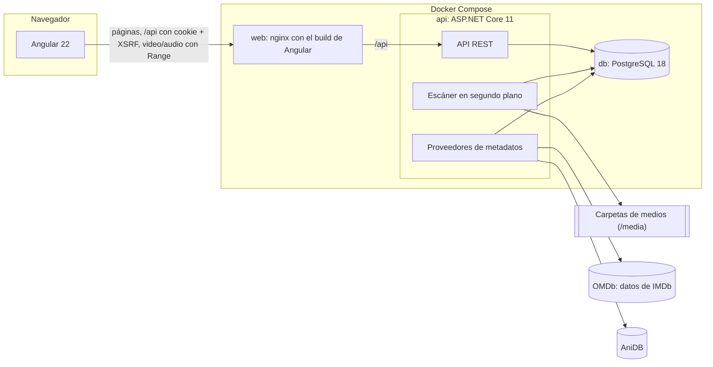
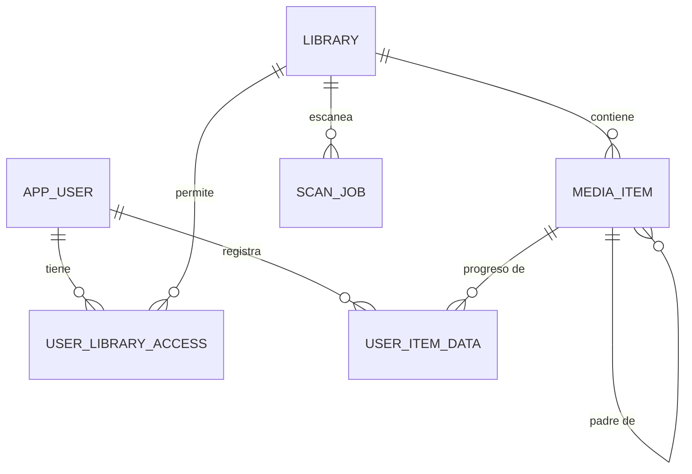

# Plan: gestor de contenido multimedia (JellyfinClon)

Aplicación web para organizar y reproducir tu propia colección de música, películas, series y anime. Toma como referencia la funcionalidad básica de Jellyfin, pero con código, modelo de datos y diseño propios. Es un proyecto de portafolio: pequeño de mantener y pensado para mostrar buenas prácticas con .NET, EF Core Code First, PostgreSQL y Angular.

> **Nombre de trabajo: Mediateca.** Para el repositorio público usa un nombre propio en lugar de "Jellyfin", que es el nombre de otro proyecto. En tu sitio aparecerá como "Gestor de contenido multimedia".

Dónde vive cada cosa:

- **Este plan:** `C:\Users\rafik\Downloads\Claude\ProyectosPortafolio\JellyfinClon\PLAN.md`. En la fase 0 se copia a la raíz del repositorio.
- **Código:** `F:\Respaldo\Respaldo\Cursos\JellifinClon`.
- **Repositorio:** uno nuevo y público en tu GitHub (`RafaelLeonTorres/<nombre>`), creado en la fase 0.

---

## 1. Alcance

### Incluye (MVP)

- **Bibliotecas** de música y de video (películas, series y anime). Cada una apunta a una o varias carpetas del servidor.
- **Escaneo** de esas carpetas: detecta archivos nuevos, modificados y eliminados.
- **Metadatos** de cada película, serie y anime: título, año, clasificación, resumen, géneros, calificación y póster, obtenidos de IMDb (a través de OMDb) y de AniDB. La música usa las etiquetas de sus archivos.
- **Identificar**: corregir una coincidencia equivocada buscando de nuevo o pegando el ID de IMDb (`tt0118799`) o de AniDB.
- **Usuarios y permisos**: el administrador crea usuarios y decide a qué bibliotecas entra cada uno.
- **Reproducción en el navegador**: video con avance y retroceso, música por álbum con una barra de reproducción fija, y "Continuar viendo".
- **Primer arranque**: si la base de datos no existe, la app la crea con sus tablas; si no hay usuarios, pide crear al administrador.

### No incluye (extensiones posibles)

- Transcodificación con FFmpeg: el MVP reproduce solo los formatos que el navegador soporta.
- Subtítulos, TV en vivo, DLNA, apps móviles, plugins y perfiles infantiles.
- Otros proveedores, como TMDb (resúmenes en español) o MusicBrainz (música). La arquitectura los admite, pero no entran en el MVP.

---

## 2. Tecnologías

| Capa | Tecnología |
|---|---|
| Backend | .NET 11 (C# 15) y ASP.NET Core 11 |
| Datos | EF Core 11, Code First con migraciones |
| Base de datos | PostgreSQL 18; PostgreSQL 19 cuando salga (lanzamiento planeado para el 19 de noviembre de 2026) |
| Proveedor de EF | Npgsql.EntityFrameworkCore.PostgreSQL 11 |
| Autenticación | ASP.NET Core Identity con cookie |
| Frontend | Angular 22 (última 22.x), Angular Material, zoneless y Vitest |
| Música | TagLibSharp para leer etiquetas y carátulas |
| Pruebas | xUnit, Moq, Testcontainers (PostgreSQL) y WebApplicationFactory; Vitest en Angular |
| Infraestructura | Docker Compose con tres contenedores (nginx con Angular, API y PostgreSQL) y GitHub Actions |

Notas de versiones:

- .NET 11 salió el 10 de noviembre de 2026. Es STS y tiene soporte hasta noviembre de 2028, igual que .NET 10.
- Angular pasó a una versión mayor por año: la 22 (junio de 2026) es la vigente y la 23 está prevista para junio de 2027. Desde la 21, los proyectos nuevos son zoneless y usan Vitest para las pruebas.
- EF Core 11 lanza un error ante cualquier API síncrona de entrada/salida, así que todo el acceso a datos debe ser `async` (`MigrateAsync`, `SaveChangesAsync`, `ToListAsync`).
- **Npgsql EF Core 11:** en la fase 0 confirma en NuGet si ya hay versión estable. Si todavía no, usa la última preliminar 11.0 y actualiza en cuanto salga la estable.

---

## 3. Arquitectura



Decisiones principales:

- **Tres contenedores, un solo origen:** `web` (nginx) sirve el build de Angular y manda `/api` al contenedor `api`; `db` es PostgreSQL. El navegador solo habla con `web`, así que la app y la API comparten origen. En desarrollo, `ng serve` hace lo mismo con `proxy.conf.json`. nginx pasa `/api` sin búfer para que el streaming con `Range` llegue directo al navegador.
- **Primer arranque con un comando:** `setup.ps1` (o `docker compose up -d --build --wait`) construye las imágenes y levanta todo; Compose espera a que cada contenedor esté sano antes de arrancar el siguiente (`db` → `api` → `web`).
- **Cookie en lugar de JWT:** las etiquetas `<video>` y `<audio>` no pueden enviar la cabecera `Authorization`, pero sí envían cookies. Con una cookie del mismo origen el streaming queda autenticado sin poner tokens en las URL.
- **Escaneo y metadatos en segundo plano:** un `BackgroundService` lee una cola (`Channel<T>`) para que la API responda al instante mientras se escanea.

Estructura de carpetas:

```text
JellifinClon/                          F:\Respaldo\Respaldo\Cursos\JellifinClon (raíz del repositorio)
├── PLAN.md                            copia de este plan
├── README.md                          primer arranque, uso diario, configuración y desarrollo
├── setup.ps1                          primer arranque en Windows: crea .env y levanta los contenedores
├── docker-compose.yml                 web, api y db
├── .env.example                       contraseña, puertos y carpeta de medios (se copia a .env)
├── backend/
│   ├── Dockerfile                     imagen de la API (SDK para compilar, ASP.NET Core para correr)
│   ├── Mediateca.slnx
│   ├── src/
│   │   ├── Mediateca.Api/             endpoints, autenticación y archivos de Angular
│   │   ├── Mediateca.Core/            entidades, reglas, analizadores de nombres e interfaces
│   │   └── Mediateca.Infrastructure/  EF Core, migraciones, escáner, OMDb, AniDB e imágenes
│   └── tests/
│       ├── Mediateca.UnitTests/
│       └── Mediateca.IntegrationTests/  Testcontainers + WebApplicationFactory
└── frontend/                          Angular 22
    ├── Dockerfile                     compila Angular con Node y lo sirve con nginx
    └── nginx.conf                     archivos de Angular, rutas de la SPA y proxy de /api
```

---

## 4. Modelo de datos (EF Core Code First)



| Entidad | Campos principales |
|---|---|
| `Library` | Id, Name, Type (`Movies`, `Series`, `Anime`, `Music`), Paths (`text[]`), CreatedAt, LastScannedAt |
| `MediaItem` (abstracta) | Id, LibraryId, ParentId, Title, SortTitle, Year, Overview, ContentRating, CommunityRating, Genres (`text[]`), ImdbId, AniDbId, PosterPath, DateAdded, MetadataStatus (`Pending`, `Matched`, `NotFound`, `Error`) |
| `PlayableItem` (abstracta, hereda de `MediaItem`) | FilePath, FileSize, FileModifiedAt, DurationSeconds |
| `Movie`, `Episode`, `Track` | heredan de `PlayableItem`. Episode: SeasonNumber, EpisodeNumber, AbsoluteNumber. Track: TrackNumber, DiscNumber, Artist |
| `Series`, `Season`, `MusicAlbum` | heredan de `MediaItem`. Season: SeasonNumber. MusicAlbum: AlbumArtist |
| `AppUser` | `IdentityUser<Guid>` + DisplayName, CreatedAt |
| `UserLibraryAccess` | UserId, LibraryId (llave compuesta) |
| `UserItemData` | UserId, ItemId, PositionSeconds, Played, LastPlayedAt (llave compuesta) |
| `MetadataCache` | Provider, ExternalId, Payload (`jsonb`), FetchedAt (llave compuesta Provider + ExternalId) |
| `ScanJob` | Id, LibraryId, Status, StartedAt, FinishedAt, Added, Updated, Removed, Errors |

Detalles que vale la pena mostrar en el portafolio:

- **Herencia TPH** (una tabla con discriminador) para todos los tipos de `MediaItem`: así una sola consulta sirve para búsquedas, "Agregado recientemente" y "Continuar viendo".
- **Tipos de PostgreSQL:** `text[]` para las rutas de las bibliotecas y los géneros, y `jsonb` para la caché de metadatos.
- **Búsqueda rápida:** la extensión `pg_trgm` con un índice GIN sobre `Title` acelera los `ILIKE '%texto%'` (`HasPostgresExtension("pg_trgm")` e índice con `gin_trgm_ops`).
- **Índice único** en (LibraryId, FilePath) para que un archivo no se registre dos veces.

---

## 5. Primer arranque

1. Al iniciar, la API ejecuta `await db.Database.MigrateAsync()`. Si la base no existe, Npgsql la crea y aplica todas las migraciones; si ya existe, solo aplica las pendientes. El usuario de PostgreSQL necesita permiso `CREATEDB`.
2. Los roles `Admin` y `Usuario` se siembran con `UseAsyncSeeding` de EF Core.
3. Se crea la carpeta de datos de la app (`data/`; en Docker, el volumen `appdata` montado en `/data`) para los pósters, las llaves de Data Protection y el volcado de títulos de AniDB.
4. `GET /api/setup/status` responde `{ "needsSetup": true }` mientras no haya usuarios. Angular manda entonces a `/setup`, donde se crea el administrador con `POST /api/setup`. Ese endpoint solo funciona mientras no exista ningún usuario; después responde 404.

---

## 6. Usuarios y permisos

- Identity con llaves `Guid` y roles `Admin` y `Usuario`. No hay registro público: solo el administrador crea cuentas.
- El administrador puede crear, editar y desactivar usuarios, restablecer contraseñas y marcar a qué bibliotecas entra cada uno.
- **Regla de visibilidad:** un usuario ve una biblioteca solo si existe `UserLibraryAccess(UserId, LibraryId)`; el administrador ve todas.
- La regla vive en un método de extensión (`VisibleTo(userId, isAdmin)`) que usan los listados, la búsqueda y las filas de inicio. Los endpoints de un elemento, sus hijos, su imagen y su stream responden **404** si el usuario no tiene acceso, para no revelar que el elemento existe.
- Las pruebas de integración verifican esta regla con dos usuarios.

---

## 7. Escaneo de bibliotecas

- En Docker, la carpeta de medios del equipo (`MEDIA_PATH` en `.env`) se monta de solo lectura en `/media`, y las bibliotecas apuntan a carpetas dentro de ella (por ejemplo, `/media/Peliculas`). Para agregar más carpetas se usa un `docker-compose.override.yml` local.
- Se dispara con un botón en la administración (`POST /api/admin/libraries/{id}/scan`). El escaneo periódico cada N horas es opcional y configurable.
- Un `BackgroundService` atiende una cola de escaneos, uno a la vez por biblioteca. `ScanJob` guarda el avance y Angular lo consulta cada 2 segundos; SignalR queda como extensión.
- **Incremental:** compara ruta, tamaño y fecha de modificación con lo guardado. Lo nuevo se crea, lo modificado se actualiza y lo que ya no existe se elimina. Los cambios se guardan en lotes.
- Extensiones reconocidas: video `.mp4 .m4v .webm .mkv` y audio `.mp3 .m4a .aac .flac .ogg .opus .wav`.

Convenciones de nombres:

| Biblioteca | Estructura esperada | Ejemplo |
|---|---|---|
| Películas | `Nombre (Año)/archivo` o `Nombre (Año).ext` | `Películas/Big Buck Bunny (2008)/Big Buck Bunny (2008).mp4` |
| Series | `Serie (Año)/Temporada NN/… SxxEyy` | `Series/Mi Serie (2019)/Temporada 01/Mi Serie S01E02.mkv` |
| Anime | `Serie/… - NN` (número absoluto) o `SxxEyy`; se ignoran las etiquetas entre corchetes | `Anime/Mi Anime/[Grupo] Mi Anime - 05 [1080p].mkv` |
| Música | `Artista/Álbum/NN - Canción`, completado con las etiquetas del archivo | `Música/Artista/Álbum (2020)/01 - Canción.flac` |

- Etiquetas opcionales en el nombre de la carpeta para no depender de la búsqueda: `[imdbid-tt0118799]` y `[anidbid-23]`.
- Los analizadores de nombres son funciones puras en `Core`, cubiertas con muchas pruebas `[Theory]`.

---

## 8. Metadatos

### IMDb a través de OMDb

La API oficial de IMDb solo se ofrece de pago por AWS Data Exchange, y los conjuntos de datos gratuitos para uso no comercial no incluyen resúmenes ni pósters. Por eso se usa **OMDb**, que trabaja con los mismos IDs de IMDb:

- Clave gratuita con un límite de 1,000 solicitudes al día.
- Entrega `Title`, `Year`, `Rated` (clasificación), `Plot` (resumen; `plot=full` para el largo), `Genre`, `imdbRating` y `Poster`, y acepta `type=movie|series|episode`.
- Flujo: buscar por título y año, elegir el ID de IMDb, pedir el detalle (`i=tt…&plot=full`) y, en series, los episodios por temporada (`i=tt…&Season=N`).

### AniDB

API HTTP en XML con estas reglas obligatorias:

- Hay que **registrar un cliente** en AniDB. Cada solicitud lleva `client`, `clientver` y `protover=1`.
- **Como máximo una solicitud cada 2 segundos**, y nunca pedir el mismo anime más de una vez al día: AniDB banea a quien lo hace.
- **Caché local obligatoria.** Las respuestas llegan comprimidas con gzip, y los errores vienen como `<error>` dentro del XML, no como códigos HTTP.
- Para buscar por título se usa el volcado `anime-titles.xml.gz`: se descarga **como máximo una vez al día**, se guarda en `data/` y en él se busca el `aid`. Después se pide `request=anime&aid=…`.
- Se aprovechan el título principal, `startdate` (año), `description` (resumen), `ratings` (calificación), `restricted` (contenido para adultos), las categorías (géneros), `picture` (póster) y la lista de episodios.

### Qué se guarda como "clasificación"

- Películas y series: el campo `Rated` de OMDb (`PG-13`, `TV-MA`, etc.).
- Anime: "18+" cuando AniDB lo marca como `restricted`; si no, queda sin clasificación.
- La calificación de la comunidad (IMDb o AniDB) se guarda aparte, en `CommunityRating`.

### Implementación

- Interfaz `IMetadataProvider` (`SearchAsync`, `GetDetailsAsync`) con `OmdbProvider` y `AniDbProvider`. El proveedor depende del tipo de biblioteca: películas y series usan OMDb, y anime usa AniDB.
- `HttpClient` tipados con tiempos de espera (`Microsoft.Extensions.Http.Resilience`). AniDB tiene un limitador compartido de 1 solicitud cada 2 s (`System.Threading.RateLimiting`) y **no** reintenta ante un error de baneo.
- `MetadataCache` guarda cada respuesta. Si OMDb responde "Daily request limit reached!", la cola de metadatos se pausa hasta el día siguiente.
- Después de cada escaneo, los elementos `Pending` entran en una cola de metadatos. El estado (`Matched`, `NotFound`, `Error`) se ve en la administración.
- **Identificar:** un diálogo muestra los resultados de búsqueda del proveedor y permite pegar un ID directamente. **Actualizar metadatos** vuelve a pedir los datos, respetando la caché.
- Los pósters se descargan una sola vez a `data/images/{itemId}.jpg` y se sirven con cabeceras de caché desde `/api/items/{id}/image`. AniDB solo entrega el nombre del archivo de la imagen: en la fase 4, arma la URL con el dominio que indique su documentación vigente.
- Los resúmenes de OMDb y AniDB llegan en inglés. Para tenerlos en español haría falta agregar TMDb como tercer proveedor (extensión).

---

## 9. Reproducción

- `GET /api/items/{id}/stream`: valida el acceso y responde con `TypedResults.PhysicalFile(ruta, mime, enableRangeProcessing: true)`. Así acepta `Range` y responde 206, que es lo que permite adelantar y regresar. La ruta siempre sale de la base de datos y se verifica que esté dentro de la carpeta de la biblioteca.
- Formatos del MVP: MP4 (H.264/AAC) y WebM para video; MP3, AAC/M4A, FLAC y Ogg/Opus para audio. Si el navegador no puede reproducir un archivo (por ejemplo, un MKV con códecs incompatibles), la app lo indica y ofrece descargarlo. Reempaquetar con FFmpeg queda como extensión.
- **Progreso:** Angular guarda la posición cada 10 segundos y al pausar o salir (`PUT /api/items/{id}/progress`). Al pasar del 90 % el elemento se marca como visto. "Continuar viendo" lista lo que tiene posición guardada y no está visto.
- **Música:** un `PlayerService` con signals (cola, pista actual y estado) alimenta una barra de reproducción fija que reproduce el álbum en orden.

---

## 10. API

| Método y ruta | Quién | Para qué |
|---|---|---|
| `GET /api/setup/status` · `POST /api/setup` | anónimo | Saber si falta configurar y crear al primer administrador |
| `POST /api/auth/login` · `POST /api/auth/logout` · `GET /api/auth/me` | anónimo / usuario | Sesión con cookie |
| `GET/POST/PUT/DELETE /api/admin/users` | admin | Usuarios |
| `PUT /api/admin/users/{id}/libraries` | admin | Bibliotecas permitidas para un usuario |
| `GET/POST/PUT/DELETE /api/admin/libraries` | admin | Bibliotecas |
| `POST /api/admin/libraries/{id}/scan` · `GET /api/admin/scans/{id}` | admin | Escanear y ver el avance |
| `GET /api/libraries` | usuario | Bibliotecas visibles |
| `GET /api/libraries/{id}/items?search=&genre=&year=&sort=&page=` | usuario | Cuadrícula con búsqueda, filtros y paginación |
| `GET /api/items/{id}` · `GET /api/items/{id}/children` · `GET /api/items/{id}/image` | usuario | Detalle, temporadas, episodios o pistas, y póster |
| `GET /api/items/{id}/stream` | usuario | Reproducción con `Range` |
| `PUT /api/items/{id}/progress` | usuario | Guardar posición y marcar como visto |
| `GET /api/me/continue-watching` · `GET /api/me/recently-added` | usuario | Filas de la pantalla de inicio |
| `GET /api/admin/items/{id}/metadata/search?query=` · `POST /api/admin/items/{id}/metadata/identify` · `POST /api/admin/items/{id}/metadata/refresh` | admin | Identificar y actualizar metadatos |

La API se documenta con OpenAPI (`Microsoft.AspNetCore.OpenApi`) y se explora con Scalar en desarrollo.

---

## 11. Frontend (Angular 22)

Pantallas:

| Ruta | Pantalla |
|---|---|
| `/setup` | Asistente del primer arranque: crea al administrador y, opcionalmente, la primera biblioteca |
| `/login` | Inicio de sesión |
| `/` | Inicio: Continuar viendo, Agregado recientemente y Mis bibliotecas |
| `/bibliotecas/:id` | Cuadrícula de pósters (o de álbumes, en música) con búsqueda, filtros por año y género, y orden |
| `/items/:id` | Detalle con póster, título, año, clasificación, calificación, géneros y resumen; temporadas y episodios, o pistas del álbum; botones de reproducir y, para el admin, Identificar |
| `/reproducir/:id` | Reproductor de video que pregunta si continuar donde te quedaste; botón de siguiente episodio |
| `/admin/bibliotecas` | Alta, edición, escaneo y estado de las bibliotecas |
| `/admin/usuarios` | Usuarios, contraseña y casillas de bibliotecas permitidas |

Estructura y prácticas:

- `core/` (sesión, cliente de la API, guards), `features/` (setup, auth, home, library, item, player, admin) y `shared/` (tarjeta de póster, insignia de clasificación).
- Componentes standalone, signals, `@if`, `@for` y `@defer`, rutas con carga diferida y guards funcionales (`authGuard`, `adminGuard`, `setupGuard`).
- `provideHttpClient(withXsrfConfiguration(...))` para que Angular mande el token XSRF solo.
- Angular Material (Material 3) con diseño adaptable. Para los formularios de la administración, Signal Forms si ya son estables en tu versión 22.x; si no, formularios reactivos.

---

## 12. Seguridad

- Contraseñas con el hash de Identity. Cookie `HttpOnly` y `SameSite=Lax`, marcada `Secure` cuando la app se sirve por HTTPS (en la red local se usa HTTP), más antiforgery de ASP.NET Core con la cabecera `X-XSRF-TOKEN`.
- Las llaves de Data Protection (cookies y antiforgery) se guardan en la carpeta de datos, así las sesiones siguen válidas cuando se recrea el contenedor de la API.
- La API y PostgreSQL solo se publican en `127.0.0.1`; desde la red local solo se llega a `web`.
- Límite de intentos de inicio de sesión con el middleware de rate limiting (por ejemplo, 5 por minuto por IP).
- Autorización en todos los endpoints: política `Admin` para la administración y regla de visibilidad para elementos, imágenes y streams.
- El cliente nunca manda rutas de archivos. Las carpetas de las bibliotecas se validan al crearlas y los streams se limitan a esas carpetas.
- Los secretos quedan fuera del repositorio, y `.gitignore` excluye `data/`, `.env` y cualquier carpeta de medios.

---

## 13. Pruebas

- **Unitarias (xUnit + Moq):**
  - analizadores de nombres de películas, series y anime, con muchos casos;
  - mapeo de respuestas de OMDb (JSON) y AniDB (XML) a partir de archivos de ejemplo, sin llamar a los servicios reales;
  - el limitador de AniDB;
  - la regla de visibilidad.
- **Integración (Testcontainers + WebApplicationFactory):**
  - con un PostgreSQL vacío, la app crea la base;
  - el setup funciona una sola vez;
  - un usuario sin acceso recibe 404 en el detalle, la imagen y el stream;
  - el stream responde 206 a una solicitud con `Range`.
- **Frontend (Vitest):** sesión, guards, `PlayerService` y un par de componentes.
- **CI (GitHub Actions):** compilar y probar el backend (los runners de Ubuntu traen Docker para Testcontainers), probar y compilar Angular, y una prueba de humo que levanta los tres contenedores y consulta `/api/health` a través de nginx.

---

## 14. Configuración

```jsonc
// appsettings.json: sin secretos
{
  "ConnectionStrings": { "Default": "Host=localhost;Port=5433;Database=mediateca;Username=mediateca" },
  "Storage": { "DataPath": "data" },
  "Metadata": {
    "Omdb":  { "ApiKey": "" },
    "AniDb": { "Client": "", "ClientVersion": 1 }
  }
}
```

- En Docker, todo sale de `.env` (contraseña de PostgreSQL, puertos, `MEDIA_PATH`, clave de OMDb y cliente de AniDB) y Compose lo pasa a la API como variables de entorno (`ConnectionStrings__Default`, `Metadata__Omdb__ApiKey`…). `.env.example` documenta cada variable y `.env` no se sube a git.
- Si corres la API fuera de Docker (con `dotnet watch`), la cadena de conexión con la contraseña va en `dotnet user-secrets`.
- Antes de la fase 4, pide tu clave en <https://www.omdbapi.com/apikey.aspx> y registra tu cliente en AniDB (necesitas una cuenta).

---

## 15. Fases

Cada fase entrega algo que funciona de punta a punta: API, pantallas y pruebas.

### Fase 0. Base del proyecto
- [x] Crear `F:\Respaldo\Respaldo\Cursos\JellifinClon` y copiar este `PLAN.md` a la raíz.
- [x] `.gitignore`, `.editorconfig` y licencia MIT.
- [x] Solución .NET 11 con `Api`, `Core`, `Infrastructure` y los dos proyectos de pruebas, generada con las plantillas oficiales y con la versión más reciente de cada paquete.
- [x] Confirmar la versión de Npgsql EF Core 11: sigue en preliminar (11.0.0-rc.3), así que EF Core queda fijado en 11.0.0 hasta que salga la estable.
- [x] App de Angular 22 con Angular Material y proxy hacia la API.
- [x] Docker Compose con tres contenedores: `web` (nginx con Angular y proxy de `/api`), `api` y `db` (PostgreSQL 18), con healthchecks, volúmenes y puertos configurables en `.env`.
- [x] `setup.ps1` y README con el primer arranque: un comando crea `.env`, revisa que los puertos estén libres (si alguno está ocupado o Windows lo reservó, usa el siguiente y lo guarda en `.env`), construye las imágenes y deja todo corriendo.
- [x] GitHub Actions que compile y pruebe el backend y el frontend, y levante los tres contenedores.
- [ ] Cuando todo el esqueleto corra en los contenedores: iniciar git, hacer el primer commit y crear el repositorio público en tu GitHub. Lo más sencillo es *Publicar en GitHub* desde el panel de control de código fuente de VS Code. Si lo creas en github.com, hazlo sin README ni licencia para que no choquen con los archivos locales.
- [ ] Trabajar con ramas y pull requests, como en el sitio, para que el workflow valide cada cambio antes de llegar a `main`.

**Entregable:** con `setup.ps1` (o `docker compose up -d --build --wait`) quedan corriendo `web`, `api` y `db`, y <http://localhost:8080> muestra que la API responde.

### Fase 1. Primer arranque y sesión
- [ ] Entidades, `DbContext` y primera migración.
- [ ] `MigrateAsync` al iniciar y roles sembrados con `UseAsyncSeeding`.
- [ ] Endpoints de setup, login, logout y `me` con cookie y XSRF.
- [ ] Angular: asistente de configuración, login y guards.
- [ ] Pruebas: una base nueva se crea sola y el setup funciona una sola vez.

**Entregable:** con un PostgreSQL vacío, la app crea la base y pide al administrador.

### Fase 2. Bibliotecas y escaneo
- [ ] Alta y edición de bibliotecas, con validación de carpetas.
- [ ] Analizadores de nombres (películas, series y anime) y lector de etiquetas de música, con pruebas.
- [ ] Escáner incremental en segundo plano y estado del escaneo.
- [ ] Angular: administración de bibliotecas, inicio, cuadrícula con búsqueda y filtros, y detalle con temporadas, episodios, álbumes y pistas.

**Entregable:** al escanear, aparecen los títulos con los datos del nombre del archivo y de las etiquetas.

### Fase 3. Usuarios y permisos
- [ ] Administración de usuarios y de sus bibliotecas permitidas.
- [ ] Regla de visibilidad en todas las consultas y 404 en los recursos ajenos.
- [ ] Angular: pantalla de usuarios con casillas por biblioteca.
- [ ] Pruebas con dos usuarios y bibliotecas distintas.

**Entregable:** dos usuarios ven bibliotecas diferentes.

### Fase 4. Metadatos
- [ ] Proveedor de OMDb: búsqueda, detalle y episodios.
- [ ] Proveedor de AniDB: volcado de títulos, detalle del anime y límite de 1 solicitud cada 2 s.
- [ ] Caché, cola de metadatos y manejo del límite diario de OMDb.
- [ ] Pósters en caché local.
- [ ] Diálogos de Identificar y Actualizar metadatos.
- [ ] Pruebas con respuestas de ejemplo.

**Entregable:** películas, series y anime muestran título, año, clasificación, resumen y póster.

### Fase 5. Reproducción
- [ ] Endpoint de stream con `Range` y tipos MIME.
- [ ] Progreso, visto/no visto, "Continuar viendo" y "Agregado recientemente".
- [ ] Angular: reproductor de video y barra de música con cola.
- [ ] Prueba: el stream responde 206.

**Entregable:** ves un video, lo cierras y continúas donde te quedaste; escuchas un álbum completo.

### Fase 6. Cierre para el portafolio
- [ ] README con descripción, capturas, diagrama y decisiones técnicas (el primer arranque ya está desde la fase 0).
- [ ] Datos de demostración con contenido libre, por ejemplo las películas abiertas de Blender (Big Buck Bunny, Sintel) con licencia Creative Commons, en la carpeta de `MEDIA_PATH`, para que las capturas no muestren material con derechos de autor.
- [ ] En el sitio, agregar `url` (el repositorio de GitHub) y `status: done` al proyecto en `_data/projects.yml`.

---

## 16. Criterios de aceptación del MVP

1. Con un PostgreSQL vacío, la primera ejecución crea la base y las tablas, y la app pide crear al administrador. Después de crearlo, el asistente ya no aparece.
2. El administrador crea bibliotecas de música, películas, series y anime. Tras escanearlas, películas, series y anime muestran título, año, clasificación, resumen y póster de OMDb o AniDB; los álbumes muestran artista, año, carátula y pistas desde las etiquetas.
3. "Identificar" corrige una coincidencia equivocada buscando o pegando un ID de IMDb o de AniDB.
4. Un usuario con acceso solo a "Películas" ve únicamente esa biblioteca. Si pide un elemento, imagen o stream de otra, recibe 404.
5. El video se puede adelantar (respuesta 206), "Continuar viendo" retoma la posición y un álbum se reproduce en orden con la barra fija.
6. Las pruebas de backend y frontend pasan en GitHub Actions.

---

## 17. Riesgos

| Riesgo | Cómo se mitiga |
|---|---|
| AniDB banea por exceso de solicitudes | Limitador de 1 cada 2 s, caché, volcado de títulos máximo una vez al día y sin reintentos ante un baneo |
| Límite de 1,000 solicitudes diarias de OMDb | Caché por ID de IMDb y pausa de la cola al llegar al límite |
| Códecs que el navegador no soporta (MKV) | Reproducción directa solo de formatos compatibles, aviso y descarga; FFmpeg como extensión |
| Coincidencias equivocadas por títulos parecidos | Año en el nombre de la carpeta, etiquetas `[imdbid-…]` y `[anidbid-…]`, y el diálogo Identificar |
| Bibliotecas grandes | Escaneo incremental, guardado en lotes, paginación e índice trigram |

---

## 18. Fuentes

- Anuncio de .NET 11: <https://devblogs.microsoft.com/dotnet/?p=61205>
- Cambios incompatibles de EF Core 11: <https://learn.microsoft.com/en-us/ef/core/what-is-new/ef-core-11.0/breaking-changes>
- Npgsql EF Core 11: <https://www.npgsql.org/efcore/release-notes/11.0.html>
- Nuevo calendario de versiones de Angular: <https://angular.love/angular-new-release-cycle-release-schedule-change-explained>
- OMDb API: <https://www.omdbapi.com/>
- AniDB, definición de la API HTTP: <https://wiki.anidb.net/HTTP_API_Definition>
- IMDb, conjuntos de datos no comerciales: <https://developer.imdb.com/non-commercial-datasets/>
- IMDb, acceso a su API (AWS Data Exchange): <https://developer.imdb.com/documentation/api-documentation/getting-access/>
